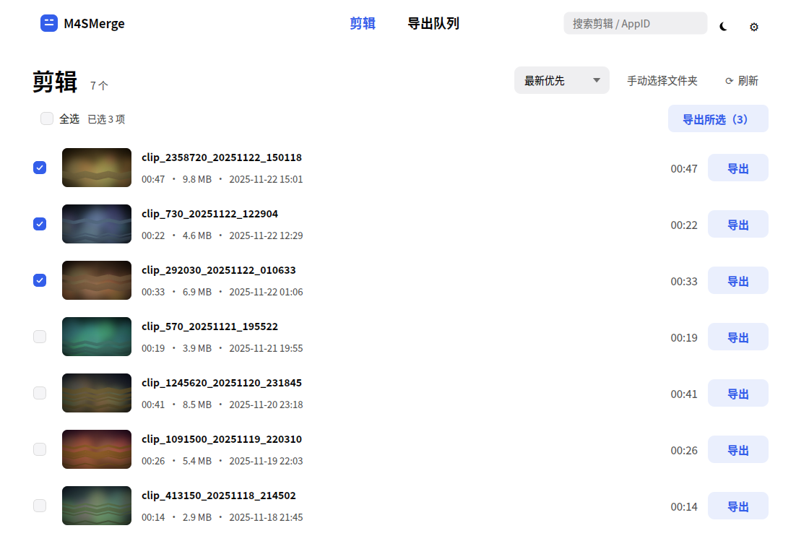
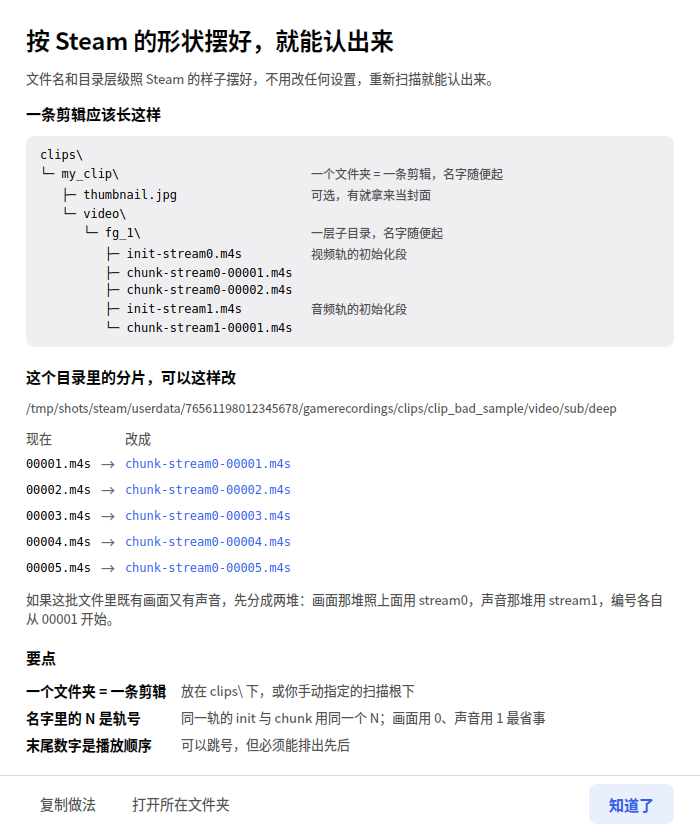
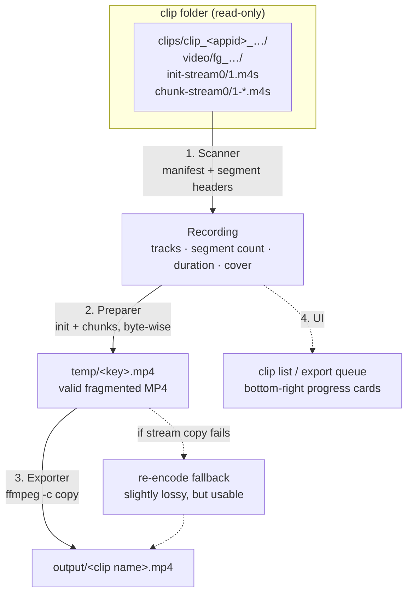

<div align="center">


# M4SMerge

**Losslessly remux Steam's `m4s` recording fragments into a plain, playable MP4.**

Portable for Windows · No re-encoding · No quality loss

[中文](README.md) · [Generic use](#generic-use) · [Usage](#usage) · [FAQ](#faq) · [Run from source](#run-from-source)

   

</div>



## What it does

Steam's built-in game recording does not produce an MP4 file; it stores DASH fragments instead:

```
Steam\userdata\<account>\gamerecordings\clips\
└── clip_413150_20251118_214502\
    ├── thumbnail.jpg            cover already rendered by Steam
    ├── clip.pb                  metadata (not parsed by this app)
    └── video\fg_413150_20251118_214502\
        ├── session.mpd          DASH manifest
        ├── init-stream0.m4s     video init segment
        ├── chunk-stream0-00001.m4s
        ├── chunk-stream0-00002.m4s
        ├── …                    (Steam writes 3-second segments)
        ├── init-stream1.m4s     audio init segment
        └── chunk-stream1-00001.m4s …
```

This layout cannot be read directly by mainstream players, editing software or video platforms.
Its payload, however, is already a complete H.264 + AAC bitstream; the only missing step is
to join the fragments of each track in sequence and place them in a standard MP4 container.

That step is exactly what M4SMerge provides: it parses fragment headers to recover track
information and duration, concatenates the bytes in order, and muxes the result with `-c copy`.

## Generic use

> **`m4s` from any source can be merged. There is exactly one requirement:
> the file names and folder layout must look like Steam's.**
>
> When they don't, the app says so — "found N m4s files, but they are not recognisable" —
> and hands you a **file-by-file rename table**. No setting to change, no restart;
> hit "Refresh" once you are done.

The app never asks *who* recorded the video. It looks for fragments, splits them into
tracks and orders them strictly by Steam's conventions. So anything else — a DASH cache
from Bilibili/YouTube, an fMP4 dump from a phone or capture card, segments you cut yourself
with ffmpeg — merges losslessly once it is shaped like this:

```
clips\
└─ my_clip\                     one folder = one clip, any name you like
   ├─ thumbnail.jpg              optional, used as the cover
   └─ video\
      └─ fg_1\                   one level of subfolder, any name
         ├─ init-stream0.m4s      video init segment
         ├─ chunk-stream0-00001.m4s
         ├─ chunk-stream0-00002.m4s
         ├─ init-stream1.m4s      audio init segment
         └─ chunk-stream1-00001.m4s
```

| What to change | Rule |
|---|---|
| Folder | One folder per clip; fragments go in `video\<anything>\`, or directly in the clip folder (the scanner looks two levels down) |
| Init segment | `init-streamN.m4s` |
| Fragments | `chunk-streamN-00001.m4s`; the trailing number is playback order and may skip values, as long as it sorts |
| Track number | Init and chunks of the same track share one `N`; `0` for video and `1` for audio is the easiest layout |

Then click **Refresh** in the main window — no restart needed.
The clip page also keeps a small "N m4s not recognised · how to rename" link next to the
title, so the table is always one click away.



**What renaming cannot fix**: encrypted fragments (CENC / DRM) and HLS `.ts` segments.
Those are not a naming problem, and this project does not plan to support them.

The rule lives in exactly one place, `app/core/naming.py`; the dialog, the README and the
"Copy the recipe" button all read from it, so they cannot drift apart. The recognition logic
itself made no concession to generic use — `scanner.py` still only understands Steam's layout.

## Features

| | |
|---|---|
| **Truly lossless** | The video stream is copied byte for byte. The merged file's video stream has the same MD5 as the source segments |
| **Fast** | Runs at disk-copy speed. A 20-second clip takes ~100 ms; a 2 GB clip takes about as long as copying 2 GB |
| **Batch** | Selecting N clips produces N separate files — never one merged file. Only one ffmpeg runs at a time, so your disk is not thrashed |
| **Never blocks the UI** | Scanning, thumbnail decoding and remuxing all run off the GUI thread; rows are inserted in batches, so even 600 clips appear instantly |
| **Free thumbnails** | Uses Steam's own `thumbnail.jpg` — no frame extraction, no video scanning |
| **No overwrites** | Name collisions get `-2`, `-3`, … Existing files are never replaced |
| **No leftovers** | Intermediate files live only in the app's `temp`, deleted on finish or exit. The recording folder is never written to |
| **Visible progress** | One card per export in the bottom-right corner; green fades after 3 s, red stays until dismissed |
| **Name it your way** | Right-click or press `F2` to rename the output; tick the timestamp box and you get `Phantom Blade Zero - 2026-11-22 23-46-00.mp4`. A batch uses each clip's own recording time |

## Performance

Merging decodes nothing: it moves a clip's bytes four times — read the segments, write the
temp file, read it back, write the final MP4. Throughput is therefore set by the disk;
the CPU only matters in the re-encode fallback.

The estimates below are anchored on a **measured 570 MB clip merged in 1.23 s**
(≈ 460 MB/s of output, PCIe 3.0 NVMe, source and destination on the same drive):

| Drive | Rated sequential R/W | Merge throughput (output) | 1 GB clip | 10 GB clip |
|---|---|---|---|---|
| SATA SSD | 550 / 500 MB/s | ≈ 230 MB/s | ≈ 4.4 s | ≈ 44 s |
| PCIe 3.0 NVMe | 3,500 / 3,000 MB/s | ≈ 460 MB/s | ≈ 2.2 s | ≈ 22 s |
| PCIe 4.0 NVMe | 7,000 / 5,000 MB/s | ≈ 800 MB/s | ≈ 1.3 s | ≈ 13 s |
| PCIe 5.0 NVMe | 14,000 / 12,000 MB/s | ≈ 1,200 MB/s | ≈ 0.9 s | ≈ 8 s |
| 7200 rpm HDD | 200 / 180 MB/s | ≈ 90 MB/s | ≈ 11 s | ≈ 1 min 50 s |

- 3.0 → 4.0 is roughly 1.7×, 4.0 → 5.0 only about 1.5×: the bottleneck moves from the drive to ffmpeg's muxing and syscalls, so a faster drive never gets saturated.
- Keeping source and output on two different drives lets reads and writes overlap — typically 20–40% faster; on one drive they queue behind each other.
- Times cover the whole export (manifest and segment headers included). Scanning hundreds of clips is a separate job and takes seconds.

**Re-encode fallback** (only when stream copy fails) barely touches the disk; it is CPU-bound:
1080p60 runs at ~150 fps on an 8-core desktop CPU (≈ 2.5× realtime), so a 10-minute clip takes
about 4 minutes — roughly 2.5 minutes on 16 cores. PCIe 3.0 / 4.0 / 5.0 differ by less than 5%.

That is also why this app only does lossless merging and offers no "re-encode to 1080p" option:
once you re-encode, the bottleneck moves from the disk to the CPU, a fast drive buys nothing,
and you pay for it in quality.

## How it works



**Restoring one track**

```
init-stream0.m4s   chunk-00001.m4s   chunk-00002.m4s   chunk-00003.m4s  …
       │                 │                 │                 │
       └──────────── concatenated in order, byte by byte ────┘
                                 ↓
                  a valid fragmented MP4 (timestamps already continuous)
                                 ↓  ffmpeg -c copy (remux only, no decoding)
                    plain MP4, video stream bit-identical to the source
```

**Why no transcoding is needed**

`m4s` is fMP4 (fragmented MP4). `init + seg1 + seg2 + …` of a single track, glued together,
is already a valid fragmented MP4. `-c copy` merely moves the index to the front and swaps
the container shell — not a single byte of H.264 is touched. Quality is frame-identical to the
original recording, and speed is bounded only by disk throughput.

**Segment boundaries are safe**

Every segment starts with an IDR frame, so the concatenated timeline is continuous and
ffprobe reports the same duration as the manifest.

## Install

1. Download `M4SMerge-win64-portable.zip` from [Releases](https://github.com/stuwjn/M4SMerge/releases/latest) and extract it anywhere (e.g. `D:\Tools\M4SMerge`)
2. Run `M4SMerge.exe`

No installer, no admin rights, no separate FFmpeg — `ffmpeg.exe` and `ffprobe.exe` are bundled.

> A single-file `M4SMerge-single.exe` is also available, at the cost of 2–3 extra seconds on startup.
>
> If a release ships source only, build the package yourself with [Build](#build).

## Usage

1. On launch the app scans `Steam\userdata\<account>\gamerecordings\clips`
2. Select one or more clips:
   - Single: click **导出 (Export)** at the end of the row
   - Batch: tick the checkboxes (or **全选 / Select all**), then click **导出所选 (N)**
3. Watch progress on the **导出队列 (Export queue)** tab; click **打开输出目录 (Open output folder)** when done

- Output name = clip folder name, e.g. `clip_413150_20251118_214502.mp4` (you can rename it, see below)
- Default output is your Videos folder; change it once in **设置 (Settings)**
- Clicking a row only highlights it — no accidental actions

**Rename the output**: right-click any row → **重命名… (Rename…)**, press `F2`, or tick several
clips and use **重命名** in the bulk bar.

- Type a name and tick **加上时间戳 (add timestamp)** to get `Phantom Blade Zero - 2026-11-22 23-46-00.mp4`
- With several clips selected the name is shared and each clip uses its own recording time; identical seconds get `-2`, so nothing is overwritten
- Names are stored in the config and survive refresh and restart; **用回文件夹名 (use the folder name)** resets them
- Only the output file name changes — the recording folder is never touched

**Nothing found?** A dialog offers three choices:

| Button | When to use |
|---|---|
| **刷新 (Refresh)** | You just saved a new clip in Steam |
| **手动选择文件夹 (Choose folder)** | Clips live elsewhere. Pick the `clips` folder, its parent `gamerecordings`, or a single clip folder — all are recognised, and the choice is remembered |
| **取消 (Cancel)** | Do nothing |

If `m4s` files were found but could not be recognised (typical for non-Steam sources),
the dialog changes to "found N m4s, but they are not recognisable" and gains a
**怎么改名 (How to rename)** button. It opens the table from
[Generic use](#generic-use), plus a per-file "rename this to that" list for your folder.

You can also drag a folder onto the window.

## What gets written

| Path | Content | Lifetime |
|---|---|---|
| `<app>\temp\` | intermediates | deleted on finish / exit, folder removed when empty |
| `<output>\*.mp4` | the result | permanent |
| `<app>\logs\export.log` | one JSON object per export, JSON Lines | never rotated, delete manually |
| `%APPDATA%\M4SMerge\settings.json` | config (incl. renamed outputs) | permanent |

The recording folder (`gamerecordings`) is **never written to**. No registry keys, nothing else on the system drive.

If the app folder is not writable (e.g. under `Program Files`), intermediates fall back to `%TEMP%\M4SMerge` and are still cleaned up.

For a fully self-contained install: drop an empty `portable.flag` next to the exe and config moves to `<app>\data\settings.json`.

## FAQ

**Does it work with m4s from other sources?**
Yes, after renaming. The app recognises fragments strictly by Steam's conventions and never
guesses: when they don't match it says "found N m4s files, but they are not recognisable" and
shows a file-by-file rename table. Shape the names and folders like Steam's, click **Refresh**,
and it works — no settings, no restart. See [Generic use](#generic-use).

**No audio after export?**
Some recordings only contain a single track (Steam records in-game audio only by default).
The row shows a warning and the output is video-only. `segments` in the log will match the video track only.

**"FFmpeg not found"?**
Put `ffmpeg.exe` in `bin\`, add it to PATH, or point to its folder in **Settings**.
Stream copy does not need an encoder, but the re-encode fallback does, so FFmpeg must be locatable.

**Antivirus flags the exe?**
PyInstaller builds are frequently false-positived. It is not malware — whitelist the folder.

**Can it trim clips?**
No, by design. Steam's built-in editor already does that; M4SMerge only turns saved fragments into a usable MP4.

**Does it modify my recordings?**
No. The recording folder is opened read-only; every intermediate lives in the app's own `temp` and is deleted afterwards.

## Run from source

Python 3.10+ and FFmpeg (`bin\` or PATH).

```bat
pip install -r requirements.txt
python -m app.main
```

## Build

```powershell
powershell -ExecutionPolicy Bypass -File scripts\build_windows.ps1
# single file: add -OneFile
```

Output lands in `dist\M4SMerge\`. The script fetches FFmpeg (`scripts\fetch_ffmpeg.ps1`) and
then invokes PyInstaller, excluding WebEngine, QML and other unused modules.

## Project layout

```
app/
├── core/
│   ├── scanner.py     locate clips, expand clip folders, detect track kinds
│   ├── naming.py      Steam's naming rules + rename hints for unrecognised folders
│   ├── mpd.py         DASH manifest parsing (SegmentTemplate / SegmentList / SegmentBase)
│   ├── recording.py   Recording model + Preparer (concat → mux)
│   ├── export.py      export jobs, progress callbacks, unique paths
│   ├── ffmpeg.py      ffmpeg/ffprobe discovery and invocation
│   ├── mp4box.py      read mp4 boxes directly to tell video from audio in microseconds
│   ├── oplog.py       export log (JSON Lines)
│   └── settings.py    config, portable mode, directory conventions
├── ui/
│   ├── main_window.py top bar + two pages + corner toasts
│   ├── library.py     clip list: checkboxes, covers, per-row export, bulk bar
│   ├── dialogs.py     settings + "how to rename unrecognised m4s"
│   ├── panels.py      export queue
│   ├── toast.py       corner progress cards
│   ├── topbar.py      navigation / search / theme toggle
│   └── theme.py       design tokens and QSS
└── resources/         icons
```

## License

Released under the [MIT](LICENSE) license.
Licensing notes for bundled FFmpeg and Qt/PySide6 are in [THIRD_PARTY_NOTICES.md](THIRD_PARTY_NOTICES.md).
