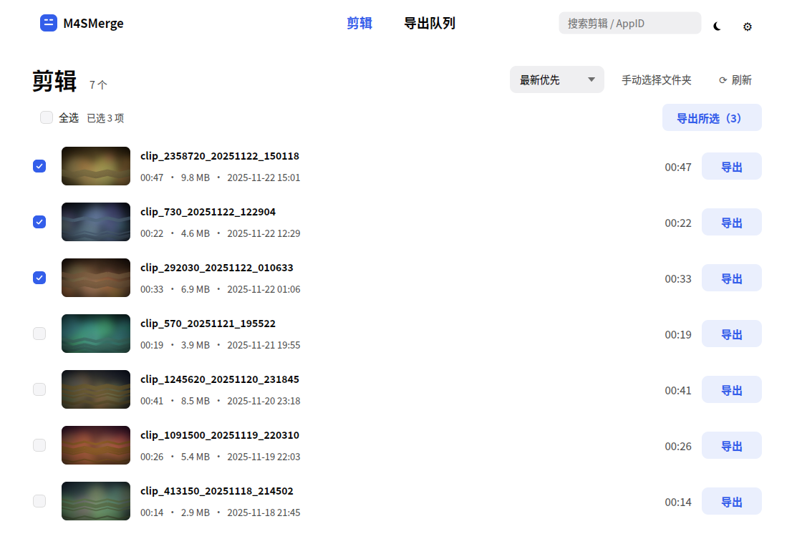
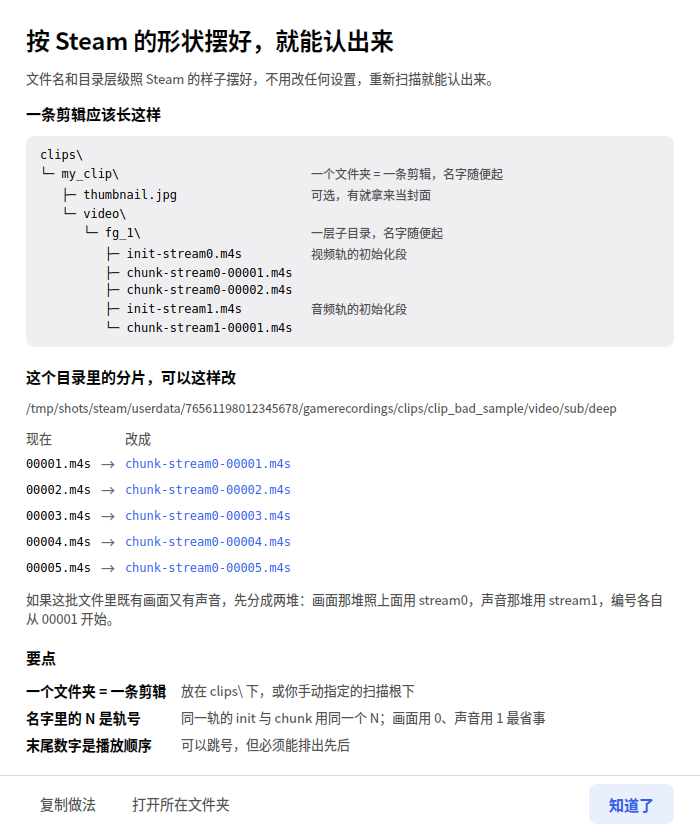
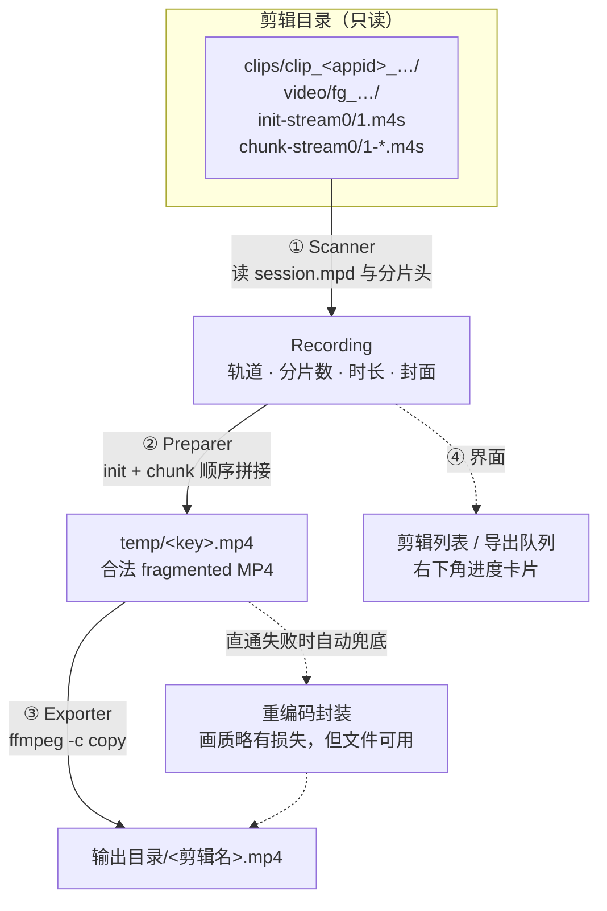

<div align="center">


# M4SMerge

**把 Steam 录制的 `m4s` 分片，无损合并成能直接播放的 MP4。**

Windows 免安装 · 不转码 · 不改画质

[English](README.en.md) · [通用性](#通用性) · [使用](#使用) · [常见问题](#常见问题) · [从源码运行](#从源码运行)

   

</div>



## 软件功能

Steam 客户端的「录制」功能并不直接生成 MP4 文件，而是以 DASH 分片的形式保存：

```
Steam\userdata\<好友码>\gamerecordings\clips\
└── clip_413150_20251118_214502\
    ├── thumbnail.jpg            Steam 已经生成好的封面
    ├── clip.pb                  元数据（本程序不解析）
    └── video\fg_413150_20251118_214502\
        ├── session.mpd          DASH 清单
        ├── init-stream0.m4s     视频轨初始化段
        ├── chunk-stream0-00001.m4s
        ├── chunk-stream0-00002.m4s
        ├── …                    （Steam 固定 3 秒一片）
        ├── init-stream1.m4s     音频轨初始化段
        └── chunk-stream1-00001.m4s …
```

该结构无法被主流播放器、剪辑软件或视频平台直接读取；但其载荷本身已是完整的
H.264 + AAC 码流，所缺的只是把同一轨道的分片按序衔接、再装入标准的 MP4 容器。

M4SMerge 负责的正是这一步：解析分片头部以还原轨道信息与时长，按字节顺序拼接，
再以 `-c copy` 封装输出。

## 通用性

> **不是 Steam 录的 `m4s` 也能合，前提只有一条：文件名与目录层级摆成 Steam 的样子。**
>
> 摆不对时程序会直接告诉你「找到 N 个 m4s，但认不出来」，
> 并给出**逐个文件的改名对照**——不用改设置，也不用重启，点「刷新」就认。

本程序不判断「这段录像是谁录的」，只按 Steam 的约定找分片、分轨、排顺序。
所以别的来源——B 站/YouTube 的 DASH 缓存、手机或采集卡的 fMP4、自己用 ffmpeg 切出来的分片——
只要改成下面这个形状，一样能无损合并：

```
clips\
└─ my_clip\                     一个文件夹 = 一条剪辑，名字随便起
   ├─ thumbnail.jpg              可选，有就拿来当封面
   └─ video\
      └─ fg_1\                   一层子目录，名字随便起
         ├─ init-stream0.m4s      视频轨的初始化段
         ├─ chunk-stream0-00001.m4s
         ├─ chunk-stream0-00002.m4s
         ├─ init-stream1.m4s      音频轨的初始化段
         └─ chunk-stream1-00001.m4s
```

| 要改的地方 | 规则 |
|---|---|
| 目录 | 一个文件夹 = 一条剪辑；分片放进 `video\<任意名>\`，也可以直接放在剪辑文件夹里（只往下看两层） |
| 初始化段 | `init-streamN.m4s` |
| 分片 | `chunk-streamN-00001.m4s`，末尾数字是顺序，可以跳号，但必须能排出先后 |
| 轨道号 | 同一轨的 init 与 chunk 用同一个 `N`；画面用 `0`、声音用 `1` 最省事 |

改完回到主界面点「刷新」即可，不需要重启程序。
主界面标题旁也会挂一条「N 个 m4s 未识别 · 怎么改名」，随时能翻出这张对照表。



**改名解决不了的**：加密分片（CENC / DRM）、HLS 的 `.ts` 分片。这两类不是文件名的问题，本项目不打算支持。

这份规则只写在 `app/core/naming.py` 一处，界面提示、README、「复制做法」按钮引的都是它，不会各说一套。
识别逻辑本身没有为通用化做任何妥协——`scanner.py` 仍然只认 Steam 的摆放方式。

## 特性

| | |
|---|---|
| **真无损** | 视频流逐字节复制，不做任何转码。合并结果的视频流 MD5 与源分片完全一致 |
| **快** | 耗时约等于拷贝同体积文件。20 秒的剪辑约 100 ms，2 GB 的剪辑约等于复制 2 GB |
| **批量** | 勾选 N 条 = 导出 N 个独立文件，**不会**合并成一个。一次只跑一个 ffmpeg，不抢磁盘 |
| **不卡界面** | 扫描、读封面、合并全在后台线程；列表分批插入，600 条也是首屏立现 |
| **封面免费** | 直接用 Steam 生成的 `thumbnail.jpg`，不抽帧、不扫视频 |
| **不覆盖** | 同名文件自动追加 `-2`、`-3`，永远不覆盖已有文件 |
| **零残留** | 中间片只写在程序目录的 `temp`，导出结束或退出即删；剪辑目录一个字节都不写 |
| **看得见进度** | 导出时右下角一条一张卡片，成功变绿 3 秒消失，失败变红**常驻**，不会被忽略 |

## 工作原理



**一条轨道是怎么还原的**

```
init-stream0.m4s   chunk-00001.m4s   chunk-00002.m4s   chunk-00003.m4s  …
       │                 │                 │                 │
       └──────────── 按字节顺序拼接 ─────────────────────────────┘
                                 ↓
                  合法的 fragmented MP4（时间戳本就连续）
                                 ↓  ffmpeg -c copy（只换容器，不解码）
                    普通 MP4，视频流与源分片逐字节一致
```

**为什么不需要转码**

`m4s` 是 fMP4（分片 MP4）。同一轨的 `init + seg1 + seg2 + …` 直接首尾相接，
本身就是一个合法的 fragmented MP4；`-c copy` 只是把索引搬到文件头部、换个容器外壳，
H.264 码流一个字节都没有动。因此画质与原始录制逐帧一致，速度只受磁盘吞吐限制。

**分片边界不会导致画面断裂**

每个分片都以 IDR 帧开头，按顺序拼接后时间戳连续，ffprobe 读出的时长与清单声明一致。

## 安装

1. 到 [Releases](https://github.com/stuwjn/M4SMerge/releases/latest) 下载 `M4SMerge-win64-portable.zip`，解压到任意目录（例如 `D:\Tools\M4SMerge`）
2. 双击 `M4SMerge.exe`

免安装、不需要管理员权限、不需要单独装 FFmpeg —— 包里已带 `ffmpeg.exe` / `ffprobe.exe`。

> 也可以下载单文件版 `M4SMerge-single.exe`，代价是每次启动多解压 2～3 秒。

## 使用

1. 启动后自动扫描 `Steam\userdata\<好友码>\gamerecordings\clips`
2. 列表里勾选一条或多条：
   - 单条导出：点这一行行尾的 **导出**
   - 批量导出：勾行首复选框（或点「全选」），点顶部 **导出所选（N）**
3. 到 **导出队列** 页看进度；完成后点「打开输出目录」

- 输出文件名 = 剪辑文件夹名，例如 `clip_413150_20251118_214502.mp4`
- 默认输出到系统「视频」文件夹，可在 **设置** 里改一次，之后一直用它
- 点某一行只会高亮，不会触发任何动作（避免手滑）

**扫不到剪辑？** 会弹提示，三个按钮：

| 按钮 | 什么时候用 |
|---|---|
| **刷新** | 刚在 Steam 里存了新剪辑，重扫一次 |
| **手动选择文件夹** | 剪辑不在默认位置。选 `clips` 目录、选它的上一层 `gamerecordings`、甚至直接选某一条剪辑都能识别；选过之后会记住 |
| **取消** | 什么都不做 |

如果扫到了 `m4s` 却认不出来（多见于非 Steam 来源），提示会换成
「找到 N 个 m4s，但认不出来」，并多一个 **怎么改名** 按钮，
点开就是上面 [通用性](#通用性) 那张对照表，还会针对你这个目录列出「哪个文件改成什么」。

也可以把文件夹直接拖进窗口。

## 输出与落盘

| 路径 | 内容 | 生命周期 |
|---|---|---|
| `<程序目录>\temp\` | 合并中的中间片 | 导出结束 / 退出即删，空了连目录一起删 |
| `<输出目录>\*.mp4` | 合并结果 | 永久（就是你要的文件） |
| `<程序目录>\logs\export.log` | 导出日志，JSON Lines，一行一条 | 不轮转、不设上限，手动删 |
| `%APPDATA%\M4SMerge\settings.json` | 配置，约 1 KB | 永久 |

剪辑目录（`gamerecordings`）**一个字节都不写**，只读。
不写注册表、不写系统盘其他位置。

程序目录不可写时（例如解压到 `Program Files`），临时文件自动退到 `%TEMP%\M4SMerge`，退出时同样清空。

想一字节都不落系统盘：在 exe 同级放一个空的 `portable.flag`，配置改写到「程序目录\data\settings.json」，
整个文件夹拷走即可迁移。

## 常见问题

**支持别的来源的 m4s 吗？**
能，但要改名。程序只按 Steam 的约定识别分片，不符合时不会硬猜——
它会提示「找到 N 个 m4s，但认不出来」，并给出逐个文件的改名对照。
把名字和目录层级摆成 Steam 的样子，点「刷新」就认，不用改设置也不用重启。
规则见 [通用性](#通用性)。

**导出后没有声音？**
个别录制只有单轨（Steam 默认只录游戏内声音）。行内会提示「单轨」，导出的就是纯画面。
日志里 `segments` 只有视频轨的数量，可据此确认。

**提示「未找到 FFmpeg」？**
把 `ffmpeg.exe` 放到 `bin\`、加入系统 PATH，或在「设置」里指定 ffmpeg 所在目录。
合并本身不需要转码，但直通失败时要靠 FFmpeg 兜底重编码，所以必须能找到。

**杀毒软件报毒？**
PyInstaller 打包的程序经常被误报，这不是病毒。把整个文件夹加入信任区即可。

**能剪切片段吗？**
不能，这是刻意收窄的：Steam 自带的剪辑器已经能做，M4SMerge 只负责把它保存出来的分片变成能用的 MP4。

**会改动我的原始文件吗？**
不会。剪辑目录全程只读；所有中间产物都在程序自己的 `temp` 里，用完即删。

## 从源码运行

需要 Python 3.10+ 与 FFmpeg（放在 `bin\` 或 PATH 里）。

```bat
pip install -r requirements.txt
python -m app.main
```

## 构建 Windows 包

```powershell
powershell -ExecutionPolicy Bypass -File scripts\build_windows.ps1
# 单文件版：加 -OneFile
```

产物在 `dist\M4SMerge\`。脚本会先下载 FFmpeg（`scripts\fetch_ffmpeg.ps1`），
再用 PyInstaller 打包，并排除 WebEngine / QML 等用不到的模块。

## 项目结构

```
app/
├── core/
│   ├── scanner.py     定位 clips、展开剪辑目录、判定轨道类型
│   ├── naming.py      Steam 的命名规则 + 「认不出的目录」改名建议（只讲不改识别）
│   ├── mpd.py         DASH 清单解析（SegmentTemplate / SegmentList / SegmentBase）
│   ├── recording.py   Recording 模型 + Preparer（字节拼接 → 封装）
│   ├── export.py      导出任务、进度回调、路径去重
│   ├── ffmpeg.py      ffmpeg/ffprobe 探测与调用
│   ├── mp4box.py      直接读 mp4 box，微秒级判断轨是视频还是音频
│   ├── oplog.py       导出日志（JSON Lines）
│   └── settings.py    配置读写、便携模式、目录约定
├── ui/
│   ├── main_window.py 顶部导航 + 两个页面 + 右下角提示
│   ├── library.py     剪辑列表：复选框、封面、行内导出、批量条、未识别提醒
│   ├── dialogs.py     设置 + 「认不出的 m4s 怎么改名」说明
│   ├── panels.py      导出队列
│   ├── toast.py       右下角进度卡片
│   ├── topbar.py      导航 / 搜索 / 主题切换
│   └── theme.py       设计令牌与 QSS
└── resources/         图标
```

## 许可

本项目以 [MIT](LICENSE) 发布。
内置 FFmpeg 与 Qt/PySide6 的许可说明见 [第三方声明](THIRD_PARTY_NOTICES.md)。
